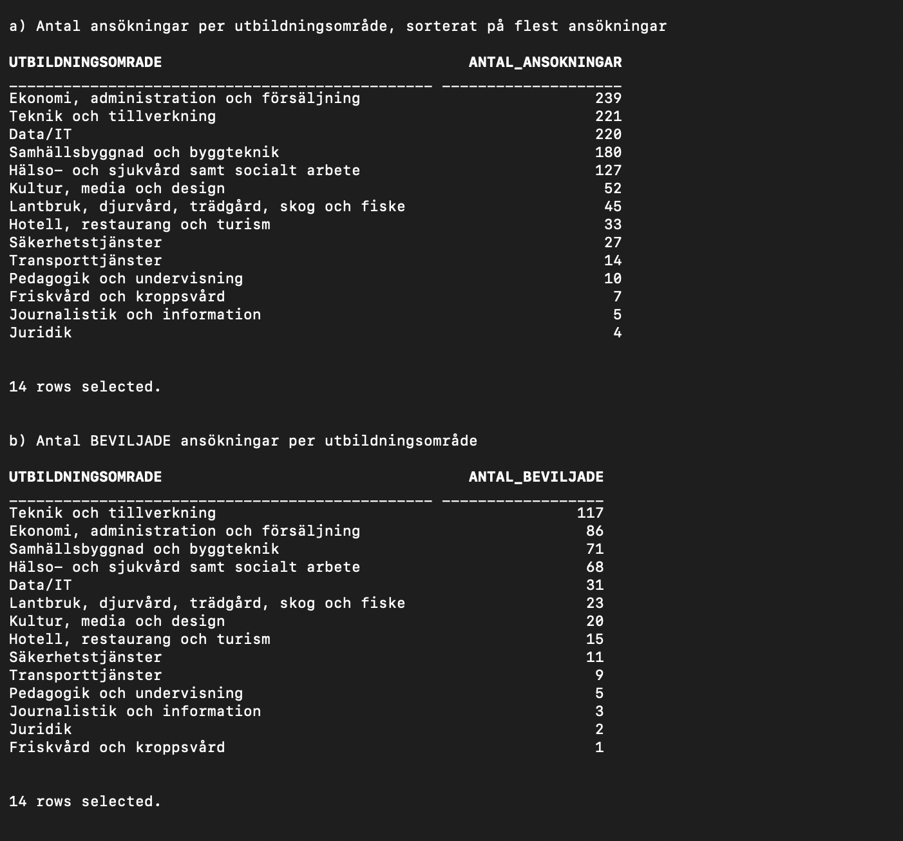
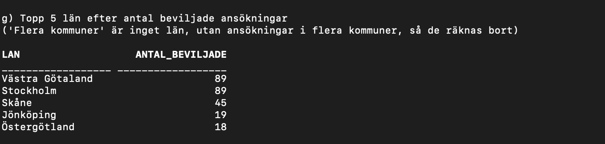
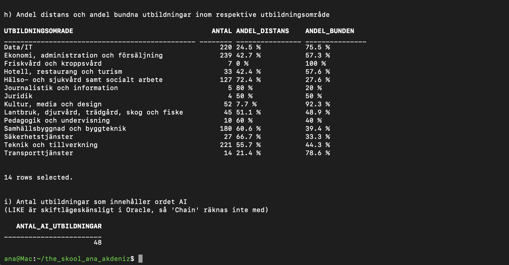
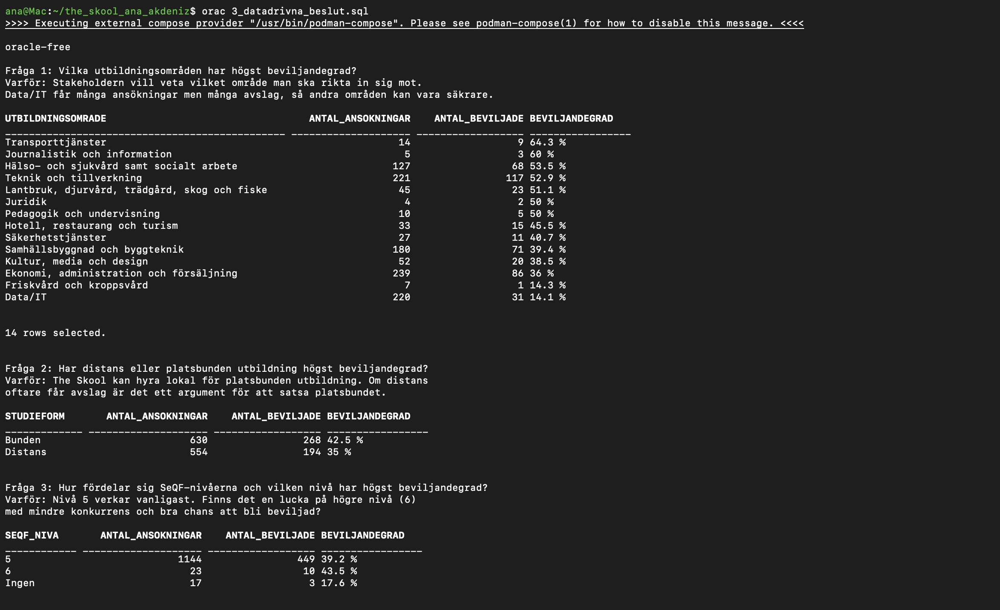
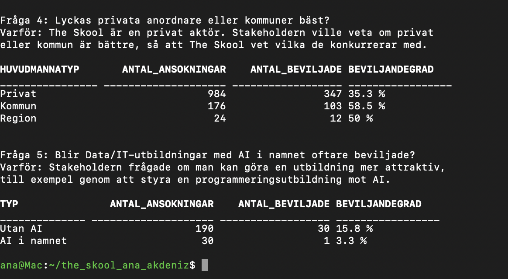

# The Skool – SQL-analys av MYH:s ansökningsomgång 2025

Labb i kursen SQL 1 (DBA26, Nackademin) av Ana Akdeniz.

## Om projektet

**The Skool** är en nystartad utbildningsanordnare som vill söka 2–3 YH-utbildningar.
Varje ansökan kostar mycket, så de vill "pricka rätt". Jag har använt SQL för att analysera
vilka ansökningar som Myndigheten för yrkeshögskolan (MYH) beviljade och avslog i
ansökningsomgång 2025, så att The Skool kan fatta datadrivna beslut.

## Datakälla

- [MYH](https://www.myh.se): Yrkeshögskolan → Resultat ansökningsomgångar → Resultat för program (YH-utbildningar från 100 poäng)
- Fil: *Resultat ansökningsomgång 2025* (publicerad 2026-01-13), utbildningar med start 2026.
- Endast **Tabell 3** används: alla ansökningar med beslut, en rad per ansökan
  (1184 ansökningar, diarienummer är unikt och används som primärnyckel).

## Verktyg

Oracle Database Free (Oracle SQL) och SQLcl i Podman på Oracle Linux, via skriptet `orac`.

## Så kör du

```bash
orac 0_load_data.sql           # skapar tabellen myh_2025 och laddar in CSV-filen
orac 1_eda.sql                 # uppgift 1
orac 3_datadrivna_beslut.sql   # uppgift 3
```

## Projektstruktur

| Fil / mapp | Innehåll |
| --- | --- |
| `data/resultat-ansokningsomgang-2025-tabell3.xlsx` | MYH-filen med bara Tabell 3 kvar |
| `data/myh_2025.csv` | Tabell 3 som CSV, inforaderna överst borttagna och kolumnerna omdöpta till snake_case |
| `0_load_data.sql` | Uppgift 0: skapar tabellen `myh_2025` och laddar in datan med `LOAD` |
| `1_eda.sql` | Uppgift 1: grundläggande EDA (a–i) |
| `notes/intervjuanteckningar.md` | Uppgift 2: anteckningar från stakeholder-intervjun |
| `3_datadrivna_beslut.sql` | Uppgift 3: egna frågor med motivering |
| `screenshots/` | Skärmdumpar av resultaten |

## Resultat

### Uppgift 1 – Grundläggande EDA

**a–b) Ansökningar och beviljade ansökningar per utbildningsområde.**
Data/IT har näst flest ansökningar (220) men bara 31 beviljade.



**g) Topp 5 län efter beviljade ansökningar.** Värdet "Flera kommuner" är inget län
och är därför bortfiltrerat. Västra Götaland och Stockholm delar förstaplatsen.



**h–i) Andel distans/bunden per område och antal utbildningar med "AI" i namnet.**
48 ansökningar innehåller "AI". `LIKE` är skiftlägeskänsligt i Oracle, så ord som
"Chain" räknas inte med.



### Uppgift 2 – Stakeholder-intervju

Intervjun med domänexperten låg till grund för frågorna i uppgift 3.
Anteckningarna finns i [notes/intervjuanteckningar.md](notes/intervjuanteckningar.md).

### Uppgift 3 – Datadrivna beslut

Fem frågor som bygger på intervjun. Beviljandegrad = andel ansökningar som blev beviljade.

| Fråga | Varför den är intressant för The Skool | Svar |
| --- | --- | --- |
| 1. Vilka områden har högst beviljandegrad? | Vilket område ska man satsa på? | Transport 64 %, vård 54 %, teknik 53 %. **Data/IT bara 14 %** |
| 2. Distans eller platsbunden? | The Skool kan hyra lokal | Bunden 42,5 %, distans 35 % |
| 3. Vilken SeQF-nivå? | Finns en lucka på högre nivå? | Nivå 6: bara 23 ansökningar men 43,5 % beviljade |
| 4. Privat eller kommun? | The Skool är privat | Kommun 58,5 %, region 50 %, privat 35 % |
| 5. Hjälper AI i namnet inom Data/IT? | Kan AI göra en utbildning attraktivare? | Nej: 1 av 30 beviljades (3 %), mot 16 % utan AI |





### Rekommendation till The Skool

- **Undvik Data/IT** som första satsning: många söker men bara 14 % beviljas.
  Att lägga till "AI" i namnet hjälper inte.
- **Satsa på platsbunden utbildning**, eftersom den beviljas oftare än distans.
- **Titta på teknik och tillverkning, vård eller transport**, som har över 50 % beviljade.
- **SeQF 6** har få sökande och något högre beviljandegrad, vilket kan vara en lucka.
- Som privat aktör konkurrerar The Skool i den grupp som har lägst beviljandegrad,
  så ansökan behöver vara extra stark.

## LLM-användning

Jag har använt Claude (Anthropic) som stöd under labben: för att rensa Excel-filen
till en CSV, felsöka setup och inläsning, ta fram och förklara SQL-frågorna, sammanställa
intervjuanteckningarna och skriva denna README. Alla frågor har jag kört själv i
Oracle och kontrollerat resultaten.

## Data dictionary (`4_data_dictionary.sql`)

Med Oracles data dictionary kan man ta fram information om databasen själv:

- `DESC myh_2025` och `USER_TAB_COLUMNS` visar tabellens 28 kolumner och datatyper
  (`VARCHAR2` för text, `NUMBER` för tal). `diarienummer` har `NULLABLE = N`.
- `USER_CONSTRAINTS` visar restriktionen av typ `P` (primary key) på `diarienummer`,
  vilket gör att varje ansökan bara kan finnas en gång.
- `USER_TABLES` visar att tabellen finns i schemat. `NUM_ROWS` är tom eftersom
  statistik inte har samlats in; det riktiga antalet (1184) fås med `COUNT(*)`.
